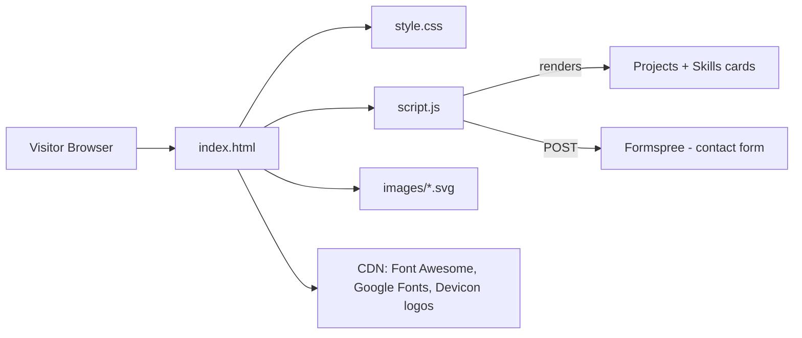
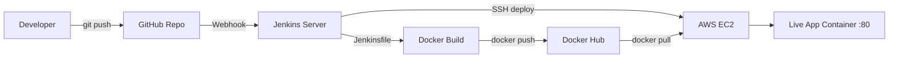
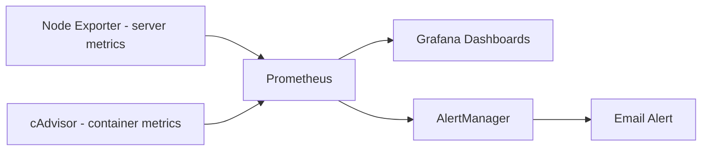

# Vinay Kumar Pal - DevOps Portfolio

Simple static portfolio website (HTML + CSS + JavaScript, no framework).
It shows **2 projects**:

1. **End-to-End CI/CD Pipeline** - GitHub -> Jenkins -> Docker -> AWS EC2
2. **Monitoring Stack** - Prometheus + Grafana + AlertManager (Docker Compose)

---

## 1. Folder structure

```
Portpolio_website/
├── index.html     -> page ka structure (sections)
├── style.css      -> design, colors, mobile responsive rules
├── script.js      -> skills, projects, theme, menu, typing, contact form
├── Me.jpg         -> profile photo
├── images/
│   ├── jenkins-pipeline.svg   -> Project 1 diagram
│   └── monitoring-stack.svg   -> Project 2 diagram
└── README.md
```

## 2. Website architecture



## 3. Project 1 - End-to-End CI/CD (GitHub to EC2)



**Flow (step by step)**
1. Developer code `git push` karta hai GitHub par.
2. GitHub **webhook** Jenkins ko trigger karta hai.
3. Jenkins `Jenkinsfile` chalata hai: code checkout -> Docker image build.
4. Image **Docker Hub** par push hoti hai.
5. Jenkins **SSH** se EC2 me jata hai, nayi image pull karke purana container hata kar naya chalata hai.
6. App EC2 ke public IP par live ho jata hai.

**Minimal Jenkinsfile example**
```groovy
pipeline {
  agent any
  environment { IMAGE = "yourdockerhubuser/myapp" }
  stages {
    stage('Checkout') { steps { checkout scm } }
    stage('Build')    { steps { sh 'docker build -t $IMAGE:latest .' } }
    stage('Push')     { steps { withCredentials([usernamePassword(credentialsId: 'dockerhub',
                                  usernameVariable: 'U', passwordVariable: 'P')]) {
                          sh 'echo $P | docker login -u $U --password-stdin && docker push $IMAGE:latest' } } }
    stage('Deploy')   { steps { sshagent(['ec2-key']) {
                          sh '''ssh -o StrictHostKeyChecking=no ec2-user@EC2_IP "
                                docker pull $IMAGE:latest &&
                                docker rm -f myapp || true &&
                                docker run -d --name myapp -p 80:80 $IMAGE:latest"''' } } }
  }
}
```
Required: Jenkins credentials `dockerhub` and `ec2-key`, EC2 security group open for ports 22 and 80.

## 4. Project 2 - Monitoring (Prometheus + Grafana)



**Flow:** exporters metrics dete hain -> Prometheus har 15s me scrape karke store karta hai -> Grafana dashboards dikhata hai -> threshold cross hone par AlertManager email bhejta hai. Sab kuch `docker compose up -d` se start hota hai.

## 5. Mobile responsive - project image

Project image ka size har screen par same shape me rehta hai (5:3). Fixed height nahi hai,
`aspect-ratio` hai, isliye mobile ya minimize karne par image cut nahi hoti:

```css
.project-thumb     { width: 100%; aspect-ratio: 5 / 3; }
.project-thumb img { width: 100%; height: 100%; object-fit: contain; }
```

## 6. Run locally

Bas `index.html` browser me kholo. Ya:
```bash
python3 -m http.server 8000   # phir http://localhost:8000
```

## 7. Customize (script.js)

| Kya badalna hai | Kahan |
|---|---|
| Skills | `SKILL_GROUPS` |
| Projects (title, text, GitHub link) | `PROJECTS` (`repo: ''` me real repo link) |
| Typing text | `TYPING_PHRASES` |
| GitHub profile link | `GITHUB_PROFILE` + `index.html` social icon |
| Resume | `Resume_Vinay_D.pdf` ko `index.html` ke saath rakho |
